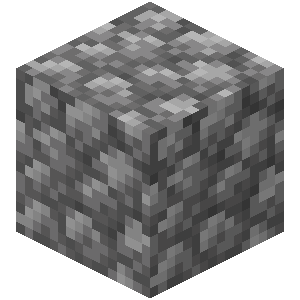

*In the vanilla version, it was difficult for us to survive in a world with only stones.
However, this mod has changed these.*

Cobblestone give birth to all things. 
Made from **MCreator** 
The modrinth's page: https://modrinth.com/mod/cobblestones

# Information
Version: 1.21.1 Neoforge 
Java: 21+ (25 is the best)

# Main Feature
* Add more electric machine
* The Battery and the machine's upgrade
* The electricity system
* Sieve
* and more...

# Else
* At the moment, the mod version is **indev**
* Please give feedback on any issues promptly.
